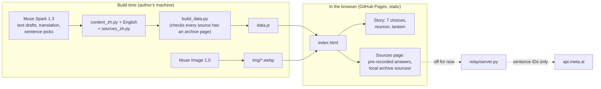

# 我們與孩子的距離 · Between Us and the Kids

**English** | [繁體中文](README.zh-TW.md)

A short story game about family policy in Taiwan: every policy helps someone, and someone else pays for it. You run the social media for a government office, and each year you can publish only half of the photo.

**[▶ Play in your browser](https://lavenhill.github.io/baby-bust/)** — free, no install, no account. Made for phones. It opens in English if your browser is set to English; otherwise tap **EN** at the top right of the title screen.<br>
Backup mirror: https://raw.githack.com/lavenhill/baby-bust/main/index.html

<table>
<tr>
<td width="25%"><br><sub>Pick which half to publish</sub></td>
<td width="25%"><br><sub>The classmates' group chat (Chinese)</sub></td>
<td width="25%"><br><sub>The 2026 reunion sky lantern</sub></td>
<td width="25%"><br><sub>Sources page with citations (Chinese)</sub></td>
</tr>
</table>

> [!NOTE]
> **Built during the hackathon.** This repository started from an empty folder. First commit: [`a689abb`](https://github.com/lavenhill/baby-bust/commit/a689abb15fad62592e59916cfb1c501172c01312), 2026-10-27 07:07 Taipei time (2026-10-26 23:07 UTC), after the event opened. Every file is new work made during the event (Oct 27 – Nov 4, 2026). Earlier prototypes were inspiration only. The full history is kept, nothing squashed: [all commits](https://github.com/lavenhill/baby-bust/commits/main).

## How it plays
- You are Vivian, a contract worker who runs social media for a fictional office on low birth rates. The story runs from 2018 to 2026.
- Each year a real policy launches. The photo has two halves: the people it helps (top) and the classmate who pays for it (bottom). You publish one half.
- Keep the people it helps: your classmate fades to grey and, at the end, walks out of the class photo.
- Keep the classmate: your boss rejects the post, you redo it overnight, and your own life fades one frame at a time.
- Each run makes 7 choices out of 10 policy scenes (128 possible paths). It ends at a 2026 class reunion in Pingxi, where you pick the words on Vivian's sky lantern from 2–3 options (no free typing).

## Why we made it
Family policy is usually discussed as budgets and headlines. In daily life the cost lands on specific people: preschool teachers, owners of small private preschools, coworkers who cover shifts. This game puts those people in the photo next to the families who benefit, and asks you to choose, year after year. You never get a choice that pleases everyone. After the ending, a sources page shows the real policy, news report or survey behind each scene.

*Fictional office, real policies. Non-partisan.*

## How Meta AI is used
| Model | What it does | Where |
|---|---|---|
| Muse Spark 1.3 (`muse-spark-1.3`) | Drafts game text (slogans, group-chat lines, private messages), the English translation, the classmates' reunion lines and the lantern lines. The author edits the final text. | `tools/content_zh.py` → `tools/build_data.py` → `data.js` (older scripts: `tools/gen_copy.py`, `tools/gen_reunion.py`) |
| Muse Spark 1.3 | Sources page: picks which verified sentences answer a question. It returns **sentence IDs only**, from a library of 134 checked sentences; the page shows those exact sentences with their links. The 8 suggested questions use answers recorded this way and checked by hand. | `tools/sources_muse.py`, `tools/sources_rec.json` |
| Muse Image 1.0 (`muse-image-1.0`) | All 64 illustrations. Character reference sheets come first; each scene (poster version and grey real-life version) is then made from those references with `images/edits`, so the same people look the same across years. | `tools/gen.py`, `tools/mkjobs.py`, `img/` |
| Muse Spark 1.3 | Quality checks: role-play playtests of early versions, and a fresh-context review of every change before it is pushed. | build process (not shipped) |

Guardrails:
- AI drafts; a person reviews and edits every line that ships.
- Facts in the game are checked against the original sources before they ship. On the sources page the model never writes a fact: it can only point to sentences in the checked library.
- The page itself calls no AI and contains no API key. All generation happens at build time.

## How it works

- **One static page.** `index.html` + `data.js`, no framework, no build step to play, no server, no key. GitHub Pages serves it.
- **Checked automatically.** `tools/play.py` (Playwright + Chromium) plays the game on phone-size screens and checks every screen for overflow and errors. It also checks all 128 paths in Chinese and English for empty or broken text, and checks every source link.
- **Sources travel with the game.** Each reference has its own page in `sources/`, so the game still shows its evidence if an original site moves.

## Sources and fact-checking
- 91 references, each with a local archive page (`sources/R01.html` – `R91.html`) linked from the game.
- 15 are government press releases, notices, Q&As and rules. They are public documents (Article 9 of Taiwan's Copyright Act) and are kept in full.
- 76 are news reports, NGO pages, a hospital page and a government survey that reserves its copyright. Only the few sentences that support the game are quoted (Article 52), with the original URL and a Wayback Machine link where one exists.
- The original page is always authoritative.

## Live questions (off for now)
The sources page is built to answer a player's own question live with Muse Spark. **That mode is switched off today:** `ASK_URL` in `index.html` is empty, so there is no question box; the page offers 8 suggested questions with pre-recorded answers, labelled as pre-recorded. The relay that would power live questions is written and tested but not yet online over HTTPS.
- `relay/server.py` (Python 3.13 standard library) sends one fixed request to `api.meta.ai` and returns at most 3 sentence IDs. No model text reaches the player.
- Limits are booked before Meta is called: 700 questions in total, US$10 in total, 30 per IP block per Taipei day, 20 per minute site-wide, 4-second timeout. When a limit is reached, or Meta does not answer, the page shows its offline mode with the pre-recorded answers.
- Question text is never stored. The API key lives only in the host's environment.
- `relay/test_relay.py` runs 27 tests against a fake Meta server. Details: [docs/ask-worker.md](docs/ask-worker.md) and the header of [relay/server.py](relay/server.py).

## Run it locally
Play:
```bash
git clone https://github.com/lavenhill/baby-bust.git
cd baby-bust
python3 -m http.server 8000   # then open http://localhost:8000/
```
Checks:
```bash
bash tools/setup_qa.sh                                  # Playwright + Chromium
python3 tools/play.py UUUDUDU /tmp/run en 390x844       # one path, English, phone size (U/D = top/bottom half)
python3 relay/test_relay.py                             # relay tests, no network
```
Rebuilding `data.js` or the images needs the author's working files and a Meta API key, so it is not one command from this repository.

## Limitations
- Live questions on the sources page are off until the relay is online; only the 8 suggested questions are answered, from recordings.
- When it is on, the relay has hard caps (700 questions, US$10). People sharing one network share 30 questions a day.
- The game is written in Traditional Chinese first. The English version was translated with Muse Spark and then reviewed.
- Facts are as of each source's publication date; the game does not update itself when a policy changes.
- `img/` still holds 28 images from the first build that the game no longer uses.

## Cost
Meta API spend recorded by the build scripts, as of 2026-10-29 (Taipei): about **US$10.14** in total — Muse Spark 1.3 US$8.80 (712 calls), Muse Image 1.0 US$1.03 (103 images), and US$0.31 for 3 test calls to Muse Wonder 1.0. This includes drafts, translation, playtests, reviews and relay tests.

## Credits and licenses
- Made by [lavenhill](https://github.com/lavenhill) for the Meta Global AI Developer Hackathon 2026.
- Text and illustrations drafted with Meta Muse Spark 1.3 and Muse Image 1.0, edited by the author.
- Code and tests were written with help from an AI coding assistant (Hark).
- Headline font `poster.woff2`: a subset of Noto Sans TC Black, SIL Open Font License 1.1 ([poster-font-OFL.txt](poster-font-OFL.txt)).
- Quoted sources belong to their publishers; see `sources/`.
- This repository has no open-source license yet, so all rights are reserved for now.

## More
- [docs/CHANGELOG.md](docs/CHANGELOG.md) — version history
- [docs/FILES.md](docs/FILES.md) — which files are current, reference or history
- [docs/devlog/](docs/devlog/) — development diary
- [docs/spec/](docs/spec/) — requirements, game spec, story graph

---

## 中文說明
完整繁體中文版說明請看 **[README.zh-TW.md](README.zh-TW.md)**。
