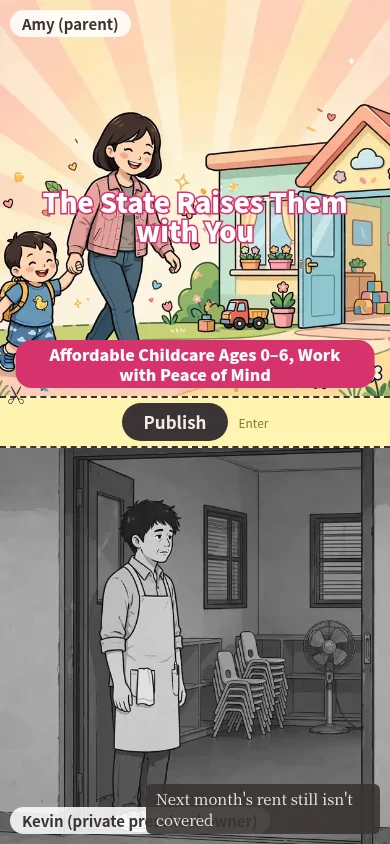
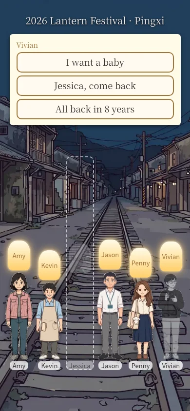
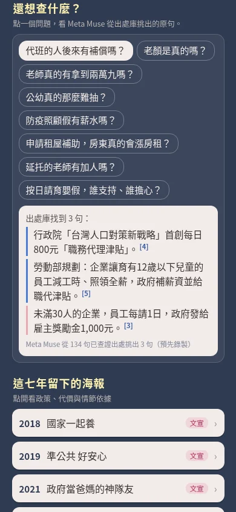
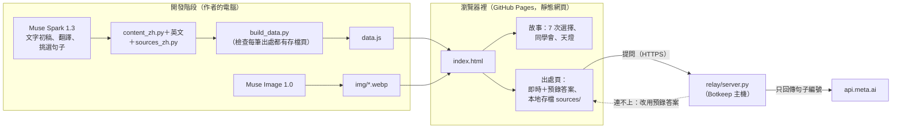

# Baby Bust

[English](README.md) | **繁體中文**

一款講台灣家庭政策的短篇故事遊戲：每項政策都幫到一些人，也總有另一些人替它付出代價。你在政府辦公室負責經營社群，每年只能發布照片的一半。

**[▶ 直接在瀏覽器玩](https://lavenhill.github.io/baby-bust/)**——免費、免安裝、免帳號，為手機設計。遊戲預設顯示中文；手機或瀏覽器設成英文時會自動顯示英文，標題畫面右上角的按鈕可以切換中英文。<br>
備用鏡像：https://raw.githack.com/lavenhill/baby-bust/main/index.html

<table>
<tr>
<td width="25%"><br><sub>選擇要發布哪一半（英文畫面）</sub></td>
<td width="25%"><br><sub>同學的群組聊天（中文畫面）</sub></td>
<td width="25%"><br><sub>2026 年同學會的天燈（英文畫面）</sub></td>
<td width="25%"><br><sub>附引用的出處頁（中文畫面）</sub></td>
</tr>
</table>

> [!NOTE]
> **黑客松活動期間的新作品。** 這個專案從一個空資料夾開始寫起。第一筆修改紀錄（commit）是 [`a689abb`](https://github.com/lavenhill/baby-bust/commit/a689abb15fad62592e59916cfb1c501172c01312)，時間是台北時間 2026-10-27 07:07（UTC 2026-10-26 23:07），在活動開始之後。每個檔案都是活動期間（2026 年 10 月 27 日至 11 月 4 日）做出的新作品。之前的試作只當作靈感。我們完整保留開發歷史，沒有把多次修改合併成一筆紀錄：[所有修改紀錄](https://github.com/lavenhill/baby-bust/commits/main)。

## 怎麼玩
- 你扮演老顏（英文版叫 Vivian），在一個虛構的少子女化辦公室擔任約聘社群小編。故事從 2018 年走到 2026 年。
- 每年都有一項真實政策上路。照片分成兩半：上半是受惠的人，下半是替政策付出代價的同學。你只能發布其中一半。
- 留下受惠的人：那位同學會慢慢變成灰色，最後走出同學會的合照。
- 留下那位同學：主管會退回貼文，你得連夜重做，你自己的生活也會一格一格褪色。
- 每一局在 10 個政策場景中做 7 次選擇（共 128 種路線）。結局是 2026 年在平溪的同學會，你從 2 到 3 個選項中替老顏挑選天燈上的字（不能自由打字）。

## 為什麼做這個遊戲
大家談家庭政策，通常只談預算和新聞標題。可是在日常生活中，代價會落在具體的人身上：幼兒園老師、小型私立幼兒園的園長、替別人代班的同事。這個遊戲把這些人放進照片，讓他們站在受惠家庭旁邊，然後請你一年又一年做出選擇。你永遠找不到讓所有人都滿意的選擇。結局之後，出處頁會列出每個場景背後的真實政策、新聞報導或調查。

*虛構的辦公室，真實的政策，不分黨派。*

## 我們怎麼使用 Meta AI
| 模型 | 用途 | 位置 |
|---|---|---|
| Muse Spark 1.3（`muse-spark-1.3`） | 起草遊戲文字（標語、群組對話、私訊）、英文翻譯、同學會台詞和天燈上的句子。作者修改後才成為正式文字。 | `tools/content_zh.py` → `tools/build_data.py` → `data.js`（較早的腳本：`tools/gen_copy.py`、`tools/gen_reunion.py`） |
| Muse Spark 1.3 | 出處頁：挑出哪幾句查證過的句子能回答問題。它**只回傳句子編號**，這些句子來自一個收有 134 句查證過句子的資料庫；頁面顯示的就是那些原句和連結。8 題建議問題的答案用同樣的方式預先錄好，再經過人工檢查確認無誤。 | `tools/sources_muse.py`、`tools/sources_rec.json` |
| Muse Image 1.0（`muse-image-1.0`） | 畫出全部 64 張插圖。我們先做角色設定圖；每個場景（海報版和灰色的現實版）再用 `images/edits` 以設定圖為參考生成，讓同一個人在不同年份看起來都一樣。 | `tools/gen.py`、`tools/mkjobs.py`、`img/` |
| Muse Spark 1.3 | 品質檢查：用角色扮演試玩早期版本，並在每次發布新版本前用全新的對話審查每一項改動。 | 開發流程（不在遊戲裡） |

把關原則：
- AI 只寫初稿；每一句上線的文字都經過人審查，並修改成最後的版本。
- 遊戲裡的事實在上線前都對照過原始出處。在出處頁上，模型從不自己寫出事實，只能指向這個資料庫裡的句子。
- 網頁本身不呼叫任何 AI，也不含任何 API 金鑰。所有生成工作都在開發階段事先做好了。

## 運作方式

- **一個靜態網頁。** 只有 `index.html` 和 `data.js`：不用框架，不用先建置就能玩，網頁裡沒有金鑰。網頁放在 GitHub Pages 上。唯一的伺服器是負責即時提問的小型中繼程式；沒有它，遊戲照樣能完整玩完。
- **自動檢查。** `tools/play.py`（Playwright＋Chromium）用手機尺寸的畫面玩遊戲，檢查每個畫面有沒有內容超出版面或出現錯誤。它也檢查中文和英文的全部 128 條路線有沒有空白或壞掉的文字，並檢查每一個出處連結。
- **出處跟著遊戲走。** 每筆參考資料在 `sources/` 裡都有自己的頁面，就算原網站搬家，遊戲仍然看得到證據。

## 出處與查證
- 共 91 筆參考資料，每筆都有一個本地存檔頁（`sources/R01.html` 到 `R91.html`），遊戲裡有連結。
- 其中 15 筆是政府的新聞稿、公告、問答和法規。這些屬於公文（台灣著作權法第 9 條），我們保存全文。
- 另外 76 筆是新聞報導、民間團體網頁、一個醫院網頁，以及一份聲明保留著作權的政府調查。我們只引用支持遊戲內容的幾句話（著作權法第 52 條），並附上原始網址；有 Wayback Machine 存檔的也附上存檔連結。
- 內容有出入時，一律以原始網頁的內容為準。

## 即時提問
出處頁會用 Muse Spark 即時回答玩家自己輸入的問題。`index.html` 把問題送到中繼程式 `https://between-us.bot-keep.xyz/api/ask`（架在 Botkeep 上）；即時答案標示「即時」和花了幾秒。8 題建議問題一律用預先錄好的答案，並標示「預先錄製」。
- **備援。** 中繼程式沒有正常回覆（任何錯誤狀態、4 秒內沒回應、網路錯誤），或主機平台的安全連線（HTTPS）停擺時，頁面不會一直等：如果問題跟某一題建議問題幾乎一樣，就顯示那一題的預錄答案（標示「預先錄製」）；其他問題顯示離線說明，建議問題照常可以點。主機平台的 HTTPS 時好時壞。
- `relay/server.py`（Python 3.13 標準函式庫）只向 `api.meta.ai` 送出一種固定格式的請求，最多回傳 3 個句子編號。模型寫的文字不會出現在玩家面前。
- 呼叫 Meta 之前會先扣除額度：總共 700 題、總共 US$10、同一個網路（IP 網段）每天（台北時間）最多 30 題（IP 取平台代理伺服器 `X-Forwarded-For` 標頭的最後一段）、全站每分鐘最多 20 題、Meta 超過 4 秒沒回應就放棄這一題。只接受遊戲本身網頁送來的請求。到達上限或 Meta 沒有回應時，頁面照上面的方式備援。
- 系統從不儲存問題文字。API 金鑰只存在主機的環境變數裡。
- `relay/test_relay.py` 用一個假的 Meta 伺服器跑 27 項測試。細節請看 [docs/ask-worker.md](docs/ask-worker.md) 和 [relay/server.py](relay/server.py) 檔案開頭的說明。

## 在自己的電腦上執行
玩遊戲：
```bash
git clone https://github.com/lavenhill/baby-bust.git
cd baby-bust
python3 -m http.server 8000   # 然後打開 http://localhost:8000/
```
執行檢查：
```bash
bash tools/setup_qa.sh                                  # 安裝 Playwright＋Chromium
python3 tools/play.py UUUDUDU /tmp/run en 390x844       # 玩一條路線、英文、手機尺寸（U/D＝上半／下半）
python3 relay/test_relay.py                             # 中繼程式測試，不需要網路
```
重新產生 `data.js` 或插圖需要作者的工作檔和 Meta API 金鑰，所以沒辦法只靠這個專案的檔案用一個指令重建這些內容。

## 限制
- 即時提問要靠中繼程式和它的主機平台；連不上時，頁面只回答 8 題建議問題，用的是錄好的答案。
- 中繼程式有硬性上限（700 題、US$10）。使用同一個網路的人，一天共用 30 題。
- 遊戲先用繁體中文寫成。英文版由 Muse Spark 翻譯，再經過人工審查校對後定版。
- 事實以各出處的發布日期為準；政策改變時，遊戲不會自動更新內容。
- `img/` 裡還留著 28 張第一版的圖片，遊戲已經不再使用這些圖片。

## 花費
開發腳本記錄的 Meta API 花費：總共不到 **US$20**，大部分是 Muse Spark 1.3 的文字呼叫，另有約 100 張 Muse Image 1.0 圖片和幾次 Muse Wonder 1.0 試用呼叫。這個數字包含初稿、翻譯、試玩、審查和中繼程式測試。

## 致謝與授權
- 由 [lavenhill](https://github.com/lavenhill) 為 Meta Global AI Developer Hackathon 2026 製作的參賽作品。
- 文字和插圖由 Meta Muse Spark 1.3 和 Muse Image 1.0 起草，再由作者修改成最後的版本。
- 程式和測試是在 AI 程式助理（Hark）的協助下寫成的。
- 標題字型 `poster.woff2`：Noto Sans TC Black 的子集，採用 SIL Open Font License 1.1（[poster-font-OFL.txt](poster-font-OFL.txt)）。
- 引用的出處屬於原發布者；請看 `sources/`。
- 這個專案還沒有採用開源授權，所以目前保留所有權利。

## 更多資料
- [docs/CHANGELOG.md](docs/CHANGELOG.md)——版本紀錄
- [docs/FILES.md](docs/FILES.md)——哪些檔案是當前版本、參考資料或歷史紀錄
- [docs/devlog/](docs/devlog/)——開發日記
- [docs/spec/](docs/spec/)——需求、遊戲規格、故事分支圖
