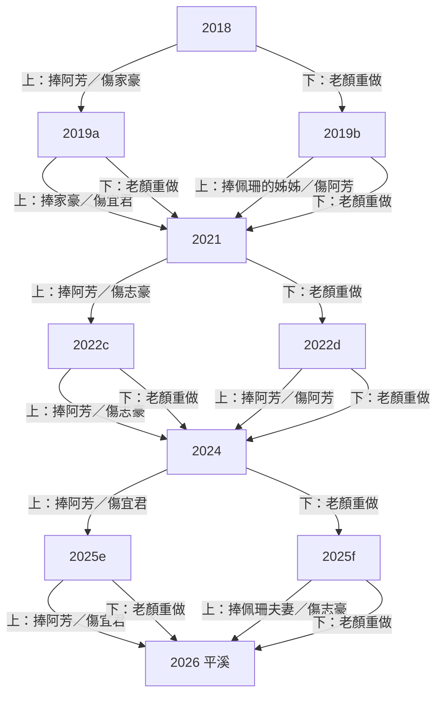

# 06 遊戲敘事與因果（v5，自動生成）

> 由 `tools/story_doc.py` 從 data.js 與引擎規則生成；機器版＝`06-story-graph.json`（同一份資料）。台詞全文對照見雲端「我們這一班_文案台詞對照」。改文案或引擎後重跑，勿手改本檔的生成段落。

## 1. 一句話
2018 年平溪放天燈，六個同學各許一個願。老顏進公部門做政策宣傳，每年要從兩張照片裁一張：上半＝政府文宣（某位同學被拍成「受益者」）、下半＝現場（同學真實的處境）。選文宣，海報被轉傳去堵那位同學的嘴；選現場，主管退件、老顏自己重做一晚。2026 年再回平溪，誰還在、誰的燈是空的，就是這八年的帳。

## 2. 狀態與因果規則

| 狀態 | 意義 | 怎麼變 | 看得到的地方 |
|---|---|---|---|
| hurt[同學] | 被犧牲次數 | 選上半 → 下半照片上的那位 +1 | 頭像劃線（1）、淡出（2） |
| gone | 退群名單 | hurt 到 2 | 「已退出群組」、之後群組不出現、他和依賴他的句子消失、2026 空燈＋私訊 |
| self | 老顏重做晚數 | 選下半 +1 | 頭像半灰（1–2）、劃線（≥3）；生活框四階 |
| laoyanGray／peishanGray | 2026 最後一刀 | 2026 選上→老顏灰；選下→佩珊灰 | 平溪燈 |
| baby | 本班小朋友數 | 隨機步數，與選擇無關 | 下一年群組貼照片 |

**群組台詞的依賴標記**：〔依賴 A〕＝A 還在群組才出現；〔依賴 A、B〕＝兩人都在才出現；〔依賴 !A〕＝A 已退群才出現。說話者本人退群，他的句子全部不出現。

**2026 是獨立的最後一刀**：不計入 hurt／gone／self，只決定誰的燈變灰（選上→老顏、選下→佩珊，佩珊願望換第二版），判詞不受影響。

## 2.1 真相表（每年選上／選下的直接後果）

| 年 | 選上（文宣） | 選下（現場） |
|---|---|---|
| 2018 | 捧阿芳；家豪 hurt+1（被拿海報堵嘴）→ 2019a | 老顏 self+1 → 2019b |
| 2019a | 捧家豪；宜君 hurt+1（被拿海報堵嘴）→ 2021 | 老顏 self+1 → 2021 |
| 2019b | 捧佩珊的姊姊；阿芳 hurt+1（被拿海報堵嘴）→ 2021 | 老顏 self+1 → 2021 |
| 2021 | 捧阿芳；志豪 hurt+1（被拿海報堵嘴）→ 2022c | 老顏 self+1 → 2022d |
| 2022c | 捧阿芳；志豪 hurt+1（被拿海報堵嘴）→ 2024 | 老顏 self+1 → 2024 |
| 2022d | 捧阿芳；阿芳 hurt+1（被拿海報堵嘴）→ 2024 | 老顏 self+1 → 2024 |
| 2024 | 捧阿芳；宜君 hurt+1（被拿海報堵嘴）→ 2025e | 老顏 self+1 → 2025f |
| 2025e | 捧阿芳；宜君 hurt+1（被拿海報堵嘴）→ 2026 | 老顏 self+1 → 2026 |
| 2025f | 捧佩珊夫妻；志豪 hurt+1（被拿海報堵嘴）→ 2026 | 老顏 self+1 → 2026 |
| 2026 | 捧佩珊 → 老顏的燈灰 | 留老顏 → 佩珊的燈灰 |

## 2.2 角色生死簿（退群要被犧牲 2 次）

- 阿芳：機會在 2019b、2022d；實際退群 8/128 條路徑
- 家豪：機會在 2018；實際退群 0/128 條路徑
- 宜君：機會在 2019a、2024、2025e；實際退群 40/128 條路徑
- 志豪：機會在 2021、2022c、2025f；實際退群 40/128 條路徑
- 佩珊：機會在 無（只在 2026 受影響）；實際退群 0/128 條路徑

**老顏生活框（選下半後）**
- 第 1 晚：家裡桌上一碗蓋著保鮮膜的飯，紙條寫「微波三分鐘」。
- 第 2 晚：考績乙等，年終少一個月。回診單上的日期劃掉，改寫「再約」。
- 第 3 晚：鍵盤旁邊，兩只戒指。
- 第 4 晚：桌上的相框，只剩一隻手。
- 第 5 晚以後：老顏又重做了一晚。

**2026 結局判詞**（gone≥2 → gone；self≥3 且無人退群 → self；其餘 → mix）
- self：同學都留在畫面裡，妳的生活被裁掉了（50/128 條路徑）
- gone：宣傳照張張漂亮，天燈少了好幾盞（12/128 條路徑）
- mix：誰都沒被放過，包括妳（66/128 條路徑）

**老顏的燈**：self≥3 →「（空白）」；self＋(2026 選上?1:0)≥1 →「回診，下週一定去。」；都沒有 →「5/24，這次不會再改期。」

## 3. 分支圖

## 4. 角色線

| 角色 | 2018 願望 | 頭像標 | 可能被犧牲的年份 | 退群機率 | 2026 願望（沒事／受過傷） |
|---|---|---|---|---|---|
| 阿芳 | 小芋頭明年抽到公幼。我回事務所上班，三十五歲升主任。 | 主任 | y2019b、y2022d | 8/128 | 升主任了。小芋頭下午有人接，不是我。／回事務所了，主任沒升。小芋頭會自己走回家了。 |
| 家豪 | 「小太陽」招生滿 60 個。爸寫的招牌要撐過第 30 年。 | 滿額 | y2018 | 0/128 | 小太陽四十八個，招牌還亮著。／小太陽剩三十個。招牌我自己補漆。 |
| 宜君 | 月薪從 26,000 變成 30,000。暑假帶我媽去沖繩，機票先訂了。 | 加薪 | y2019a、y2024、y2025e | 40/128 | 三萬二。今年暑假帶媽去沖繩，只請到三天。／三萬了。沖繩，明年一定。 |
| 志豪 | 九點前下班。存到 80 萬頭期款，買得起才敢跟小雯求婚。 | 求婚 | y2021、y2022c、y2025f | 40/128 | 還沒存到八十萬，下個月先求婚。戒指拿出抽屜了。／還在存。小雯說她不急，我急。 |
| 佩珊 | 三十歲前生第一個。請假不用跟任何人道歉。 | 當媽 | 2026（最後一刀） | 0/128 | 孩子會叫媽媽了。請假單還是先寫不好意思。／請假還是會道歉。孩子很好。 |
| 老顏 | 明年 5/24 ♡ | 戒指 | 2026（最後一刀） | 0/128 | 見老顏的燈 |

## 5. 逐年劇情（只列使用中的台詞）

### 2018　
- 政策出處：準公共化：ETtoday 2020-01-02；育兒津貼：全教總 2019-03-21
- 主管交辦：準公共上路，家長月付不到 4,500。部長下週記者會，要家長的笑臉。／命題：宣傳圖畫付得起的家長，還是撐不住的私幼？
- 同學群組：
  - 阿芳：中了！月付四千五，婆婆叫我快回去上班
  - 家豪：恭喜啦，但那間就在我對面欸
  - 阿芳：欸你這樣講我很難開心欸　〔依賴 家豪〕
  - 家豪：家長拿傳單問我憑什麼收一萬
  - 宜君：別吵啦，我兩萬六誰來幫我QQ
  - 志豪：我還在加班，你們先別吵啦
- **上半・文宣**（阿芳）：「國家一起養」0–6 歲 平價托育 安心上班；旁註：註冊費要先付一整學期
- **下半・現場**（家豪）：「每間教室都有老師」私幼一起顧 孩子不漏接；旁註：下個月房租還沒著落
- 選上 → 犧牲 **家豪**（hurt+1）→ 下一年 y2019a
  - 轉傳：小太陽家長群・家長｜施壓：海報寫月付四千五，妳憑什麼收一萬？｜家豪回應（第一次）：這學期少十五個。招牌的漆掉了，我爸還在補。｜第二次：家豪已退出群組
- 選下 → 老顏重做一晚（self+1）→ 主管：私幼不是部長這次要講的。今晚重做。 → 下一年 y2019b

### 2019a　
- 政策出處：全教總 2019-03-21（中央社、ETtoday）；準公共作業要點薪資下限 29,000
- 主管交辦：今年要多兩百家掛準公共，數字不夠，上面會問。／命題：畫私幼轉型成功，還是老師的薪水？
- 同學群組：
  - 家豪：我家新招牌掛上了，超亮快來拍
  - 宜君：園長大人，說好的兩萬九呢？　〔依賴 家豪〕
  - 家豪：那是平均啦，獎金都算進去我也沒辦法　〔依賴 宜君〕
  - 宜君：笑死，我實拿兩萬六　〔依賴 家豪〕
  - 阿芳：私訊吵啦，我還在等公幼欸　〔依賴 家豪、宜君〕
  - 志豪：家豪請吃飯啦，我加班先閃　〔依賴 家豪〕
- **上半・文宣**（家豪）：「準公共 好安心」私幼加入 平價又優質；旁註：表格填到半夜兩點
- **下半・現場**（宜君）：「老師的薪水 國家顧」教保員加薪 留住好老師；旁註：媽媽問我要不要轉行
- 選上 → 犧牲 **宜君**（hurt+1）→ 下一年 y2021
  - 轉傳：小太陽老師群・園長家豪｜施壓：海報都說國家補了，大家共體時艱。｜宜君回應（第一次）：我實拿還是兩萬六。｜第二次：宜君已退出群組
- 選下 → 老顏重做一晚（self+1）→ 主管：薪水查核是別科的事，今年只拍掛牌。重做。 → 下一年 y2021

### 2019b　
- 政策出處：TVBS 2019-05-26；台灣醒報 2019-10-15
- 主管交辦：公幼抽籤放榜。增班是今年的政績，議員要看抽中的人。／命題：畫抽中的家長，還是沒抽到的？
- 同學群組：
  - 佩珊：我姊備取三年，今年終於中了！
  - 阿芳：恭喜。我備取 87　〔依賴 佩珊〕
  - 佩珊：啊……對不起我不知道　〔依賴 阿芳〕
  - 阿芳：沒事，小芋頭再等一年而已　〔依賴 佩珊〕
  - 家豪：來我這啦，我還缺五個欸　〔依賴 阿芳〕
  - 宜君：阿芳抱一個🫂　〔依賴 阿芳〕
- **上半・文宣**（佩珊的姊姊）：「公幼擴大 好入學」每年增班 家長好安心；旁註：老二明年還要再抽
- **下半・現場**（阿芳）：「每個孩子都有位子」備取不再等 托育一起顧；旁註：私幼註冊單先放包包
- 選上 → 犧牲 **阿芳**（hurt+1）→ 下一年 y2021
  - 轉傳：家族群組・阿芳的婆婆｜施壓：海報上別人家都中了，妳呢？｜阿芳回應（第一次）：回事務所的事，又往後延一年。｜第二次：阿芳已退出群組
- 選下 → 老顏重做一晚（self+1）→ 主管：議員要看的是抽中的。誰要看備取？重做。 → 下一年 y2021

### 2021　
- 政策出處：勞動部 2021-05-17
- 主管交辦：全國停課，照顧假准請但不給薪。現在要的是安心，不是問題。／命題：畫在家陪孩子的媽媽，還是幫忙代班的同事？
- 同學群組：
  - 阿芳：停課了，明天只能請無薪假
  - 志豪：妳請假，妳的班就丟我這了　〔依賴 阿芳〕
  - 阿芳：那我請你喝飲料（外送）　〔依賴 志豪〕
  - 志豪：九點前下班？我現在連飯都在電腦前吃
  - 佩珊：都辛苦啦，我備孕也先暫停了
  - 家豪：我園也停課，學費都快退光了
- **上半・文宣**（阿芳）：「政府當爸媽的神隊友」防疫照顧假 安心陪伴；旁註：白天開視訊，晚上補工作
- **下半・現場**（志豪）：「謝謝每一位補位的你」同舟共濟 一起撐過去；旁註：便當冰了，還沒吃完
- 選上 → 犧牲 **志豪**（hurt+1）→ 下一年 y2022c
  - 轉傳：茶水間公告・志豪的經理｜施壓：海報說爸媽有政府罩，你就多補一點位。｜志豪回應（第一次）：那一年，我沒在天黑前到過家。｜第二次：志豪已退出群組
- 選下 → 老顏重做一晚（self+1）→ 主管：現在不是講這個的時候。妳也不想考績吃乙吧？ → 下一年 y2022d

### 2022c　
- 政策出處：內政部 2022-03-31；行政院 2022-06-30
- 主管交辦：300 億租金補貼，育兒家庭最高 1.8 倍。年底前要看到有感。／命題：畫領到補貼的家庭，還是被漲租的人？
- 同學群組：
  - 阿芳：有補貼，終於敢去看兩房了！
  - 志豪：房東說大家都有領，下期漲五百剛好
  - 阿芳：你快結婚啦，也來領嘛😝　〔依賴 志豪〕
  - 志豪：對啊，所以我 80 萬又遠了　〔依賴 阿芳〕
  - 宜君：好啦，我沖繩基金也掰了
  - 佩珊：志豪去抽社宅，我也想抽了啦　〔依賴 志豪〕
- **上半・文宣**（阿芳）：「租屋有補貼 成家更安心」育兒家庭 最高 1.8 倍；旁註：新家只比舊家大一點
- **下半・現場**（志豪）：「青年租屋 國家挺你」單身青年 一樣照顧；旁註：房東說下期要漲五百
- 選上 → 犧牲 **志豪**（hurt+1）→ 下一年 y2024
  - 轉傳：房東｜施壓：海報說你們都有領，漲五百怎麼了？｜志豪回應（第一次）：我根本沒領到。頭期款又少一個月。｜第二次：志豪已退出群組
- 選下 → 老顏重做一晚（self+1）→ 主管：單身不是這次主打。重做。 → 下一年 y2024

### 2022d　
- 政策出處：教育部 2021-02-04
- 主管交辦：育兒津貼加到每月 5,000。部長要「在家陪伴」的畫面。／命題：畫領津貼在家的媽媽，還是想回去上班的媽媽？
- 同學群組：
  - 阿芳：五千入帳了，在家帶也好
  - 佩珊：真的嗎？妳之前不是說要升主任　〔依賴 阿芳〕
  - 阿芳：留停快到了，公司在問了欸。孩子誰顧？
  - 志豪：懂欸，我加班也不知道在拚什麼　〔依賴 阿芳〕
  - 阿芳：我也不知道啊！
  - 宜君：都行啦，妳不欠誰　〔依賴 阿芳〕
- **上半・文宣**（阿芳）：「育兒津貼 5,000」在家陪伴 也有支持；旁註：一天只睡四小時
- **下半・現場**（阿芳）：「生孩子 不用丟工作」托育一起顧 職場不中斷；旁註：工作證先收進抽屜
- 選上 → 犧牲 **阿芳**（hurt+1）→ 下一年 y2024
  - 轉傳：面試・人資｜施壓：海報說在家顧也有五千，妳幹嘛出來找工作？｜阿芳回應（第一次）：我在平溪寫的是三十五歲升主任。｜第二次：阿芳已退出群組
- 選下 → 老顏重做一晚（self+1）→ 主管：她自己選的。重做。 → 下一年 y2024

### 2024　
- 政策出處：行政院；全教產 2024-05-03；聯合報 2024-07-08
- 主管交辦：國家一起養 2.0，公幼延托到傍晚。這是今年的主軸。／命題：畫準時接孩子的家長，還是留到六點半的老師？
- 同學群組：
  - 阿芳：延托到六點，我終於接得到！謝謝宜君老師🙏
  - 宜君：嗚我顧到六點半，水都沒喝到
  - 阿芳：欸那我晚點去接？　〔依賴 宜君〕
  - 宜君：……妳試試看　〔依賴 阿芳〕
  - 家豪：老師辛苦了，我招生還差十個
  - 志豪：我六點半還在公司，羨慕啦
- **上半・文宣**（阿芳）：「0–6 歲國家一起養 2.0」延托到傍晚 下班不用趕；旁註：還是要先衝出公司
- **下半・現場**（宜君）：「老師也要準時下班」延托增人力 老師不過勞；旁註：水壺整天沒空去裝
- 選上 → 犧牲 **宜君**（hurt+1）→ 下一年 y2025e
  - 轉傳：家長 LINE・家長｜施壓：海報說延托到六點，這本來就是老師該做的吧？｜宜君回應（第一次）：薪水是漲了，我每天站十一個小時。｜第二次：宜君已退出群組
- 選下 → 老顏重做一晚（self+1）→ 主管：老師的事另案處理。考績要打了，別在這時候。 → 下一年 y2025f

### 2025e　
- 政策出處：聯合報 2025-08-05（宜蘭頭城鎮立幼兒園寒暑假要求教師到園）；國教署 2025-05-27
- 主管交辦：寒暑假托育缺口要補，議員點名要「全年有開」。／命題：畫放心的家長，還是請不到假的老師？
- 同學群組：
  - 阿芳：暑假也有地方送了！
  - 阿芳：宜君好久沒講話了……　〔依賴 !宜君〕
  - 阿芳：宜君妳們園也有開嗎　〔依賴 宜君〕
  - 宜君：有。班表出來了，沖繩的機票我退了
  - 阿芳：……我收回剛剛的開心　〔依賴 宜君〕
  - 宜君：沒事啦，我媽說明年再去
  - 佩珊：明年一起去，我請假不道歉了　〔依賴 宜君〕
  - 家豪：伴手禮記我帳，招生幫推啦　〔依賴 宜君〕
- **上半・文宣**（阿芳）：「寒暑假 照常收托」全年不打烊 家長免煩惱；旁註：暑假一樣要上班
- **下半・現場**（宜君）：「老師也有寒暑假」休息充電 才能照顧更好；旁註：機票改到過年後了
- 選上 → 犧牲 **宜君**（hurt+1）→ 下一年 y2026
  - 轉傳：園務會議・主任｜施壓：海報說全年有開，假單先收回。｜宜君回應（第一次）：我媽說明年再去。她明年七十了。｜第二次：宜君已退出群組
- 選下 → 老顏重做一晚（self+1）→ 主管：老師休假不是亮點，議員那邊我交代不了。重做。 → 下一年 y2026

### 2025f　
- 政策出處：內政部 2025-09-04
- 主管交辦：社宅婚育優先加碼。名單要見報。／命題：畫拿到鑰匙的夫妻，還是排在最後的人？
- 同學群組：
  - 佩珊：我們中了！三十三了，終於敢生
  - 志豪：恭喜。單身排最後，戒指還在抽屜　〔依賴 佩珊〕
  - 佩珊：快求婚啦，有抽有希望嘛　〔依賴 志豪〕
  - 志豪：求了也要有地方住啊　〔依賴 佩珊〕
  - 阿芳：加油啦，小雯會等你的啦　〔依賴 志豪〕
  - 宜君：群組改名抽籤人生好了，我媽還在等我帶她飛
- **上半・文宣**（佩珊夫妻）：「敢婚敢生 政府全力支持」婚育宅 優先入住；旁註：貸款還是要三十年
- **下半・現場**（志豪）：「每個人都有家」單身青年 住得安心；旁註：租約還有十一個月
- 選上 → 犧牲 **志豪**（hurt+1）→ 下一年 y2026
  - 轉傳：小雯的媽媽｜施壓：海報上人家有房才敢生，你拿什麼娶我女兒？｜志豪回應（第一次）：我什麼都沒說，把戒指放回抽屜。｜第二次：志豪已退出群組
- 選下 → 老顏重做一晚（self+1）→ 主管：要的是拿鑰匙的照片，單身不是對象。重做。 → 下一年 y2026

### 2026　最終年・平溪
- 政策出處：勞動部 2025-09-04；行政院 2025-12-11；中央社 2026-07-16
- 主管交辦：育嬰留停可以按日請了。／命題：這張妳自己裁：拍請假的佩珊，還是留下來的妳？
- 同學群組：
  - 佩珊：明天下午請半天，孩子打疫苗
  - 佩珊：顏座，我的案子先放妳那🙏
  - 阿芳：真好，我當年只能一次請完
  - 志豪：老顏又要加班了吧
  - 宜君：老顏妳也要請假啊
- **上半・文宣**（佩珊）：「按日請育嬰假」彈性陪伴 工作家庭兩相顧；旁註：走之前又道歉了一次
- **下半・現場**（老顏）：「謝謝每一位補位的你」職務代理 一起撐；旁註：桌上有兩只戒指
- 選上：佩珊的海報留下 → 老顏的燈灰。選下：老顏自己的照片留下 → 佩珊的燈灰、願望換第二版。→ 結局

## 6. 結局私訊（缺席者）

- `佩珊|y2026`（0 條路徑看得到）：妳沒拍我請假那年，我請三個半天，群組道歉兩次，回來只看到妳桌上我的卷宗。
- `宜君|y2019a`（0 條路徑看得到）：妳沒拍我那年，我28K薪資袋薄薄的，加薪泡湯，我媽叫我轉行別撐。
- `宜君|y2019a,y2024`（16 條路徑看得到）：妳沒拍那兩年，我先守著28K薪水條，後來守著冷便當，累到六點半才吃。
- `宜君|y2019a,y2024,y2025e`（0 條路徑看得到）：妳沒拍我的那三年，加薪落空、便當六點半才冷著吃、假單被退改機票，累到笑不出來。
- `宜君|y2024`（0 條路徑看得到）：妳說延托到傍晚好棒，我六點半才扒冷便當，飯都硬了。
- `宜君|y2024,y2025e`（24 條路徑看得到）：妳沒拍的那兩年，我便當六點半才吃，假單被退，機票改到過年後。
- `家豪|y2018`（0 條路徑看得到）：妳沒拍我的那年，隔壁變準公共，我少了十五個學生，大班併班，名牌貼到重疊。
- `志豪|y2021`（0 條路徑看得到）：妳沒拍的那年停課，我連上十二天，便當冷了還在代班。
- `志豪|y2021,y2022c`（32 條路徑看得到）：妳沒拍我的那兩年，我連上十二天班，便當都涼了，房租還漲只能續約。
- `志豪|y2021,y2022c,y2025f`（0 條路徑看得到）：妳沒拍我的那幾年，我連上十二天、便當漲租照吞，最後連租屋都排最後。
- `志豪|y2021,y2025f`（8 條路徑看得到）：妳沒拍我的那兩年，2021我連上12天便當冷掉，2025婚育宅沒份續租，累積起來很悶欸。
- `志豪|y2025f`（0 條路徑看得到）：妳沒拍我的那年，婚育宅我排最後，只能把續租約塞回抽屜。
- `阿芳|y2019b`（0 條路徑看得到）：妳沒拍我那年，我捏著備取72號小紙條，兒子只好先去私幼，我回去上班又晚了一年。
- `阿芳|y2019b,y2022d`（8 條路徑看得到）：妳沒拍我的那兩年，我先抽籤落榜抱著繳費單哭，後來直接辭職在家泡奶粉。
- `阿芳|y2022d`（0 條路徑看得到）：妳沒拍我的那年，五千塊下來，我把識別證收進抽屜，在家拍拍睡了一年。

## 7. 自動檢查發現（給作者／審稿）

- 全部 128 條路徑；退群人數分布：0 人 52 條、1 人 64 條、2 人 12 條
- 永遠看不到的私訊（10）：佩珊|y2026、宜君|y2019a、宜君|y2019a,y2024,y2025e、宜君|y2024、家豪|y2018、志豪|y2021、志豪|y2021,y2022c,y2025f、志豪|y2025f、阿芳|y2019b、阿芳|y2022d
- 從不會退群的同學：家豪、佩珊
- 佩珊只在 2026 受影響，不進 hurt／gone，故 `佩珊|y2026` 私訊不會出現。
- 生活框第 3 晚為空，由「兩只戒指」頂替（設計如此）。

## 8. 待決（Muse 審稿 R1＋經理判斷，2026-10-28）
已直接改（文件層）：分支圖改「捧誰／傷誰」、加真相表與生死簿、定義依賴標記、2026 獨立規則、JSON 加 visible_if／choices。
待作者定（劇情層）：
1. 家豪只有 2018 一次機會，永不退群 → 建議 2024 或 2025 加一次以家豪為下半的機會。
2. 10 封私訊永遠看不到（單次受傷版、三次版、佩珊 2026）→ 建議：受傷 1 次未退群的人，結局也收到「安慰版」私訊；三次版刪除。
3. 判詞 gone 只有 12/128 → 建議 gone≥2 優先，或 self 門檻提高到 4。
4. 分支讓「選下」決定下一年犧牲誰（例：2021 選下進 2022d 只剩阿芳可傷）→ 保留為設計，或在文件／主管句點破。
5. 數字不一致：私訊寫備取 72 號、28K，群組是 87、26K → 統一為 87、26K（私訊另外整批改寫「連上十二天」等舊句）。
6. 2026 群組佩珊叫老顏「顏座」、把案子交給她 → 需交代同部會或改口吻。
7. 老顏生活框第 3 晚只有道具（兩只戒指）→ 是否補事件。
8. 2022d 上下都是阿芳：使用者 10-27 已定保留，不改。
