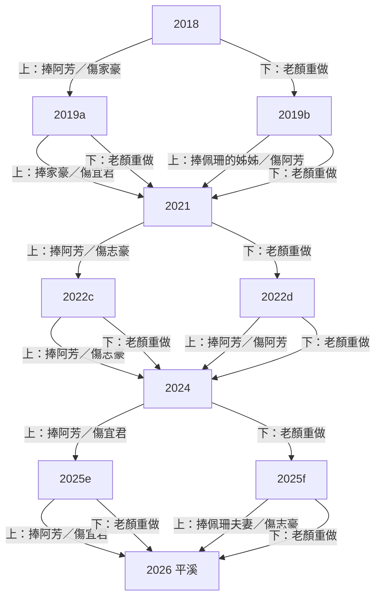

# 06 遊戲敘事與因果（r4，自動生成）

> 由 `tools/story_doc.py` 從 data.js 與引擎規則生成；機器版＝`06-story-graph.json`（同一份資料）。台詞全文對照見雲端「我們與孩子的距離_文案台詞對照」。改文案或引擎後重跑，勿手改本檔的生成段落。

## 1. 一句話
2018 年平溪放天燈，六個同學各許一個願。老顏進公部門做政策宣傳，每年要從兩張照片裁一張：上半＝政府文宣（某位同學被拍成「受益者」）、下半＝現場（同學真實的處境）。選文宣，海報被外人拿去堵那位同學的嘴（只由同學在群組轉述）；選現場，主管退件、老顏自己重做一晚。2026 年再回平溪，誰還在、誰的燈是空的，就是這八年的帳。

## 2. 狀態與因果規則

| 狀態 | 意義 | 怎麼變 | 看得到的地方 |
|---|---|---|---|
| hurt[同學] | 被犧牲次數 | 選上半 → 下半照片上的那位 +1 | 頭像劃線（1）、淡出（2） |
| gone | 退群名單 | hurt 到 2 | 「已退出群組」、之後群組不出現、他和依賴他的句子消失、2026 空燈＋私訊 |
| self | 老顏重做晚數 | 選下半 +1 | 頭像半灰（1–2）、劃線（≥3）；生活框四階 |
| laoyanGray／peishanGray | 2026 最後一刀 | 2026 選上→老顏灰＋佩珊 hurt+1；選下→佩珊灰 | 平溪燈、佩珊私訊 |
| baby | 本班小朋友數 | 隨機步數，與選擇無關 | 下一年群組貼照片 |

**群組台詞的依賴標記**：〔依賴 A〕＝A 還在群組才出現；〔依賴 A、B〕＝兩人都在才出現；〔依賴 !A〕＝A 已退群才出現。說話者本人退群，他的句子全部不出現。

**2026 是最後一刀**：不計入 gone／self。選上→老顏的燈灰，佩珊 hurt+1（群組後果＋結局受傷一次版私訊）；選下→佩珊的燈灰、願望換第二版。判詞不受影響。

## 2.1 真相表（每年選上／選下的直接後果）

| 年 | 選上（文宣） | 選下（現場） |
|---|---|---|
| 2018 | 捧阿芳；家豪 hurt+1（被拿海報堵嘴）→ 2019a | 老顏 self+1 → 2019b |
| 2019a | 捧家豪；宜君 hurt+1（被拿海報堵嘴）→ 2021 | 老顏 self+1 → 2021 |
| 2019b | 捧佩珊的姊姊；阿芳 hurt+1（被拿海報堵嘴）→ 2021 | 老顏 self+1 → 2021 |
| 2021 | 捧阿芳；志豪 hurt+1（被拿海報堵嘴）→ 2022c | 老顏 self+1 → 2022d |
| 2022c | 捧阿芳；志豪 hurt+1（被拿海報堵嘴）→ 2024 | 老顏 self+1 → 2024 |
| 2022d | 捧阿芳；阿芳 hurt+1（被拿海報堵嘴）→ 2024 | 老顏 self+1 → 2024 |
| 2024 | 捧阿芳；宜君 hurt+1（被拿海報堵嘴）→ 2025e | 老顏 self+1 → 2025f |
| 2025e | 捧阿芳；宜君 hurt+1（被拿海報堵嘴）→ 2026 | 老顏 self+1 → 2026 |
| 2025f | 捧佩珊夫妻；志豪 hurt+1（被拿海報堵嘴）→ 2026 | 老顏 self+1 → 2026 |
| 2026 | 捧佩珊 → 老顏的燈灰；佩珊 hurt+1 | 留老顏 → 佩珊的燈灰 |

## 2.2 角色生死簿（退群要被犧牲 2 次）

- 阿芳：機會在 2019b、2022d；實際退群 8/128 條路徑
- 家豪：機會在 2018；實際退群 0/128 條路徑
- 宜君：機會在 2019a、2024、2025e；實際退群 40/128 條路徑
- 志豪：機會在 2021、2022c、2025f；實際退群 40/128 條路徑
- 佩珊：機會在 2026（只會受傷一次）；實際退群 0/128 條路徑

**老顏生活框（選下半後）**
- 第 1 晚：家裡桌上一碗蓋著保鮮膜的飯，紙條寫「微波三分鐘」。
- 第 2 晚：年終考核乙等：續聘名單有她，薪點同一級。取卵那天的格子，改成「再約」兩個字。
- 第 3 晚：鍵盤旁邊，兩只戒指。
- 第 4 晚：桌上的相框，只剩一隻手。
- 第 5 晚以後：老顏又重做了一晚。

**2026 結局判詞**（gone≥2 → gone；self≥3 且無人退群 → self；其餘 → mix）
- self：同學都留在畫面裡，妳的生活被裁掉了（50/128 條路徑）
- gone：宣傳照張張漂亮，天燈少了好幾盞（12/128 條路徑）
- mix：誰都沒被放過，包括妳（66/128 條路徑）

**老顏的燈（L1 天燈拍，2026-10-28）**：玩家替老顏寫燈（12 字內，中文 1、英數 0.5；可空白；髒話打碼▇）→ 5 秒升空 → 佩珊傳照片 → 一位在群同學回一句 → 對照「燈上／海報上（2026 實際留下那張的主標）」。回應規則依序：
- prof（髒話／空白）：家豪→佩珊；各路徑回應者 {'家豪': 128}；台詞：家豪「這盞燈寫得最真心，哈哈哈」／佩珊「這盞的照片先放我這裡，不好意思」
- name（燈上最先出現且仍在群組的同學名）：被點名者；各路徑回應者 {'被點名者': 128}；台詞：阿芳「燈上有我的名字，照片留給小芋頭啦😝」／家豪「我的名字在燈上，比小太陽的招牌還亮，哈哈哈」／宜君「看到我的名字，這張留給我媽，QQ」／志豪「燈上有我的名字，照片我留給小雯。」／佩珊「燈上有我的名字，這次妳的案子放我這邊，不好意思」
- date（5/24|524|5月24|她|結婚|婚|戒指|登記|約會|改期|在一起|伴侶|求婚）：佩珊；各路徑回應者 {'佩珊': 128}；台詞：佩珊「「{w}」那天的案子放我這邊，不好意思」
- doc（回診|醫生|醫院|身體|健康|看病|掛號|取卵|凍卵|打針|排卵）：宜君→佩珊；各路徑回應者 {'佩珊': 40, '宜君': 88}；台詞：宜君「「{w}」喔，那天換我盯妳的掛號單，QQ」／佩珊「「{w}」那天，桌上的案子放我這邊，不好意思」
- sleep（睡|休息|累|放假|假期|休假）：家豪→佩珊；各路徑回應者 {'家豪': 128}；台詞：家豪「「{w}」這個願，我也要一份，哈哈哈」／佩珊「多睡一點，請假單我幫妳放桌上，不好意思」
- sorry（對不起|原諒|抱歉|欠|道歉）：志豪→家豪→佩珊；各路徑回應者 {'家豪': 40, '志豪': 88}；台詞：志豪「沒有誰欠誰。」／家豪「燈上那句，群組裡的人都還在這邊，哈哈哈」／佩珊「這句心意在我這邊，往後的案子放我桌上就好，不好意思」
- class（阿芳|家豪|宜君|志豪|佩珊|大家|同學|群組|回來）：佩珊；各路徑回應者 {'佩珊': 128}；台詞：佩珊「「{w}」這盞，我拍下來傳到群組，不好意思」
- work（辭職|離職|不做|海報|換工作|升|科長|考績|上班|加班|主管）：家豪→佩珊；各路徑回應者 {'家豪': 128}；台詞：家豪「「{w}」喔，這盞燈飛得比招牌還高，哈哈哈」／佩珊「工作的心願最大，妳的案子交給我，不好意思」
- other（其他）：佩珊；各路徑回應者 {'佩珊': 128}；台詞：佩珊「老顏的燈飛最高，不好意思」

## 3. 分支圖

## 4. 角色線

| 角色 | 2018 願望 | 頭像標 | 可能被犧牲的年份 | 退群機率 | 2026 願望（沒事／受過傷） |
|---|---|---|---|---|---|
| 阿芳 | 小芋頭明年抽到公幼。我回事務所上班，三十五歲升主任。 | 主任 | y2019b、y2022d | 8/128 | 升主任了。小芋頭下午有人接，不是我。／回事務所了，主任沒升。小芋頭會自己走回家了。 |
| 家豪 | 「小太陽」招生滿 60 個。爸寫的招牌要撐過第 30 年。 | 滿額 | y2018 | 0/128 | 小太陽四十八個，招牌還亮著。／小太陽剩三十個。招牌我自己補漆。 |
| 宜君 | 月薪從 26,000 變成 30,000。暑假帶我媽去沖繩，機票先訂了。 | 加薪 | y2019a、y2024、y2025e | 40/128 | 三萬二。今年暑假帶媽去沖繩，只請到三天。／三萬了。沖繩，明年一定。 |
| 志豪 | 九點前下班。存到 80 萬頭期款，買得起才敢跟小雯求婚。 | 求婚 | y2021、y2022c、y2025f | 40/128 | 還沒存到八十萬，下個月先求婚。戒指拿出抽屜了。／還在存。小雯說她不急，我急。 |
| 佩珊 | 三十歲前生第一個。請假不用跟任何人道歉。 | 當媽 | 2026（最後一刀） | 0/128 | 孩子會叫媽媽了。請假單還是先寫不好意思。／請假還是會道歉。孩子很好。 |
| 老顏 | 明年 5/24 ♡ | 戒指 | 2026（最後一刀） | 0/128 | 玩家寫（L1） |

## 5. 逐年劇情（只列使用中的台詞）

### 2018　
- 政策出處：準公共化：ETtoday 2020-01-02；育兒津貼：全教總 2019-03-21
- 主管交辦：準公共上路，家長月付不到 4,500。部長下週記者會，要家長的笑臉。／命題：宣傳圖畫付得起的家長，還是撐不住的私幼？
- 同學群組：
  - 阿芳：中了！月付四千五，婆婆叫我快回去上班
  - 家豪：恭喜啦，但那間就在我對面欸
  - 阿芳：欸你這樣講我很難開心欸　〔依賴 家豪〕
  - 家豪：家長拿傳單問我憑什麼收一萬
  - 宜君：別吵啦，我兩萬六誰來幫我QQ
  - 志豪：我還在加班，你們先別吵啦
- **上半・文宣**（阿芳）：「國家一起養」0–6 歲 平價托育 安心上班；旁註：註冊費要先付一整學期
- **下半・現場**（家豪）：「每間教室都有老師」私幼一起顧 孩子不漏接；旁註：下個月房租還沒著落
- 選上 → 犧牲 **家豪**（hurt+1）→ 下一年 y2019a
  - 群組後果（家豪第1次）：
    - 家豪：今天有家長拿月付四千五那張來堵我
    - 家豪：問我憑什麼還收一萬啦，哈哈哈
    - 家豪：這學期少了十五個小朋友，招牌的漆也掉了一大片
- 選下 → 老顏重做一晚（self+1）→ 主管：私幼不是部長這次要講的。今晚重做。 → 下一年 y2019b

### 2019a　
- 政策出處：全教總 2019-03-21（中央社、ETtoday）；準公共作業要點薪資下限 29,000
- 主管交辦：今年要多兩百家掛準公共，數字不夠，上面會問。／命題：畫私幼轉型成功，還是老師的薪水？
- 同學群組：
  - 家豪：我家新招牌掛上了，超亮快來拍
  - 宜君：園長大人，說好的兩萬九呢？　〔依賴 家豪〕
  - 家豪：那是平均啦，獎金都算進去我也沒辦法　〔依賴 宜君〕
  - 宜君：笑死，我實拿兩萬六　〔依賴 家豪〕
  - 阿芳：私訊吵啦，我還在等公幼欸　〔依賴 家豪、宜君〕
  - 志豪：家豪請吃飯啦，我加班先閃　〔依賴 家豪〕
- **上半・文宣**（家豪）：「準公共 好安心」私幼加入 平價又優質；旁註：表格填到半夜兩點
- **下半・現場**（宜君）：「老師的薪水 國家顧」教保員加薪 留住好老師；旁註：媽媽問我要不要轉行
- 選上 → 犧牲 **宜君**（hurt+1）→ 下一年 y2021
  - 群組後果（宜君第1次）：
    - 宜君：今天開會園長拿那張說國家都補貼學費了啦
    - 宜君：笑死，共體時艱，我實拿還是兩萬六QQ
    - 家豪：……那個園長就是我爸，不好意思啦　〔依賴 家豪〕
- 選下 → 老顏重做一晚（self+1）→ 主管：薪水查核是別科的事，今年只拍掛牌。重做。 → 下一年 y2021

### 2019b　
- 政策出處：TVBS 2019-05-26；台灣醒報 2019-10-15
- 主管交辦：公幼抽籤的放榜日。政院說四年增 2,247 班，今年要拍抽中的笑臉。／命題：畫抽中的家長，還是沒抽到的？
- 同學群組：
  - 佩珊：我姊備取三年，今年終於中了！
  - 阿芳：恭喜。我備取 87　〔依賴 佩珊〕
  - 佩珊：啊……對不起我不知道　〔依賴 阿芳〕
  - 阿芳：沒事，小芋頭再等一年而已　〔依賴 佩珊〕
  - 家豪：來我這啦，我還缺五個欸　〔依賴 阿芳〕
  - 宜君：阿芳抱一個🫂　〔依賴 阿芳〕
- **上半・文宣**（佩珊的姊姊）：「公幼擴大 好入學」每年增班 家長好安心；旁註：老二明年還要再抽
- **下半・現場**（阿芳）：「每個孩子都有位子」備取不再等 托育一起顧；旁註：私幼註冊單先放包包
- 選上 → 犧牲 **阿芳**（hurt+1）→ 下一年 y2021
  - 群組後果（阿芳第1次）：
    - 阿芳：有人把那張丟進小芋頭的家長群組啦
    - 阿芳：大家互問抽籤結果，我只能回一個備取😝
    - 阿芳：備取87啦，回事務所又要延一年
- 選下 → 老顏重做一晚（self+1）→ 主管：要的是增班的成果，備取不是重點。重做一張。 → 下一年 y2021

### 2021　
- 政策出處：勞動部 2021-05-17
- 主管交辦：全國停課，照顧假准請但不給薪。現在要的是安心，不是問題。／命題：畫在家陪孩子的媽媽，還是幫忙代班的同事？
- 同學群組：
  - 阿芳：停課了，明天只能請無薪假
  - 志豪：妳請假，妳的班就丟我這了　〔依賴 阿芳〕
  - 阿芳：那我請你喝飲料（外送）　〔依賴 志豪〕
  - 志豪：九點前下班？我現在連飯都在電腦前吃
  - 佩珊：都辛苦啦，我備孕也先暫停了
  - 家豪：我園也停課，學費都快退光了
- **上半・文宣**（阿芳）：「政府當爸媽的神隊友」防疫照顧假 安心陪伴；旁註：白天開視訊，晚上補工作
- **下半・現場**（志豪）：「謝謝每一位補位的你」同舟共濟 一起撐過去；旁註：便當冰了，還沒吃完
- 選上 → 犧牲 **志豪**（hurt+1）→ 下一年 y2022c
  - 群組後果（志豪第1次）：
    - 佩珊：志豪他們經理把海報貼茶水間啦　〔依賴 佩珊〕
    - 佩珊：說爸媽有政府罩，加班就交給單身的人　〔依賴 佩珊〕
    - 志豪 01:12：那一年，我沒有一天在天黑前回到家門口
- 選下 → 老顏重做一晚（self+1）→ 主管：現在不是講這個的時候。年底考核，關係到妳明年的約。 → 下一年 y2022d

### 2022c　
- 政策出處：內政部 2022-03-31；行政院 2022-06-30；TVBS 2022-07-20、2022-09-28（房客申請租補，房東漲租）
- 主管交辦：300 億租金補貼，育兒家庭最高 1.8 倍。年底前要看到有感。／命題：畫領到補貼的家庭，還是被漲租的人？
- 同學群組：
  - 阿芳：有補貼，終於敢去看兩房了！
  - 志豪：房東說大家都有領，下期漲五百剛好
  - 阿芳：你快結婚啦，也來領嘛😝　〔依賴 志豪〕
  - 志豪：對啊，所以我 80 萬又遠了　〔依賴 阿芳〕
  - 宜君：好啦，我沖繩基金也掰了
  - 佩珊：志豪去抽社宅，我也想抽了啦　〔依賴 志豪〕
- **上半・文宣**（阿芳）：「租屋有補貼 成家更安心」育兒家庭 最高 1.8 倍；旁註：新家只比舊家大一點
- **下半・現場**（志豪）：「青年租屋 國家挺你」單身青年 一樣照顧；旁註：房東說下期要漲五百
- 選上 → 犧牲 **志豪**（hurt+1）→ 下一年 y2024
  - 新聞卡：房客申請租補，房東漲全棟房租（TVBS 2022-07-20、2022-09-28）
  - 群組後果（志豪第2次，之後退群）：
    - 佩珊：志豪你房東那邊還好嗎啦　〔依賴 佩珊〕
    - 志豪 02:47：房東說要申請就漲租金，我就沒送申請表了。頭期款又少一個月。
- 選下 → 老顏重做一晚（self+1）→ 主管：單身不是這次主打。重做。 → 下一年 y2024

### 2022d　
- 政策出處：教育部 2021-02-04
- 主管交辦：育兒津貼加到每月 5,000。部長要「在家陪伴」的畫面。／命題：畫領津貼在家的媽媽，還是想回去上班的媽媽？
- 同學群組：
  - 阿芳：五千入帳了，在家帶也好
  - 佩珊：真的嗎？妳之前不是說要升主任　〔依賴 阿芳〕
  - 阿芳：留停快到了，公司在問了欸。孩子誰顧？
  - 志豪：懂欸，我加班也不知道在拚什麼　〔依賴 阿芳〕
  - 阿芳：我也不知道啊！
  - 宜君：都行啦，妳不欠誰　〔依賴 阿芳〕
- **上半・文宣**（阿芳）：「育兒津貼 5,000」在家陪伴 也有支持；旁註：一天只睡四小時
- **下半・現場**（阿芳）：「生孩子 不用丟工作」托育一起顧 職場不中斷；旁註：工作證先收進抽屜
- 選上 → 犧牲 **阿芳**（hurt+1）→ 下一年 y2024
  - 群組後果（阿芳第1次）：
    - 阿芳：今天去面試，人資拿那張堵我啦
    - 阿芳：在家顧也有五千，空白兩年要我怎麼解釋經歷😝
    - 阿芳：留停到期，我就先提辭呈了，升主任又離我更遠一步啦
  - 群組後果（阿芳第2次，之後退群）：
    - 佩珊：阿芳好久沒傳訊息到群組了……　〔依賴 佩珊〕
    - 阿芳：人資說在家顧也有五千，空白那兩年的事，我不想再對任何人解釋一遍
- 選下 → 老顏重做一晚（self+1）→ 主管：她自己選的。重做。 → 下一年 y2024

### 2024　
- 政策出處：行政院；全教產 2024-05-03（公幼延托到下午 6 時、有的到晚上 7 時；特教學生助理員時薪 183 元，常常找不到人）；聯合報 2024-07-08（偏鄉公幼教師一人顧全班，不敢喝水，「遲早得膀胱炎」）
- 主管交辦：國家一起養 2.0，公幼延托到傍晚。這是今年的主軸。／命題：畫準時接孩子的家長，還是留到六點半的老師？
- 同學群組：
  - 阿芳：延托到六點，我終於接得到！謝謝宜君老師🙏
  - 宜君：嗚我顧到六點半，水都沒喝到
  - 阿芳：欸那我晚點去接？　〔依賴 宜君〕
  - 宜君：……妳試試看　〔依賴 阿芳〕
  - 家豪：老師辛苦了，我招生還差十個
  - 志豪：我六點半還在公司，羨慕啦
- **上半・文宣**（阿芳）：「0–6 歲國家一起養 2.0」延托到傍晚 下班不用趕；旁註：還是要先衝出公司
- **下半・現場**（宜君）：「老師也要準時下班」延托增人力 老師不過勞；旁註：水壺整天沒空去裝
- 選上 → 犧牲 **宜君**（hurt+1）→ 下一年 y2025e
  - 群組後果（宜君第1次）：
    - 宜君：家長傳延托到六點那張給我啦
    - 宜君：笑死，說這本來就是老師該做的吧QQ
    - 宜君：考上公幼第一年，每天站十一小時啦
  - 群組後果（宜君第2次，之後退群）：
    - 佩珊：宜君好久沒傳訊息到群組了……　〔依賴 佩珊〕
    - 宜君：嗯，顧到六點是應該的，站十一小時而已
- 選下 → 老顏重做一晚（self+1）→ 主管：老師的事是另一案。年終考核就在下個月，別在這時候。 → 下一年 y2025f

### 2025e　
- 政策出處：中央社 2024-01-26，刊於聯合新聞網（公幼寒暑假加托改定額，每月最多 2,000 元）；國教署 2025-05-27（公幼寒暑期加托每月 2,000 元，開辦率 95%）
- 主管交辦：台南教育局長在全國會議提案：公幼寒暑假，家長月付最多兩千。／命題：畫放心的家長，還是沒有暑假的老師？
- 同學群組：
  - 阿芳：公幼暑假也有加托班了，老二有著落啦🙏
  - 阿芳：群組裡好久沒有宜君的訊息了……　〔依賴 !宜君〕
  - 宜君：笑死，我們園的加托班表排到八月底QQ　〔依賴 宜君〕
  - 阿芳：欸……那妳的沖繩呢🙏　〔依賴 宜君〕
  - 宜君：沖繩的機票，變成一張退票單啦　〔依賴 宜君〕
  - 佩珊：明年一起去沖繩，算我一份啦　〔依賴 宜君〕
  - 志豪：暑假？上班族沒有這兩個字啦　〔依賴 志豪〕
- **上半・文宣**（阿芳）：「寒暑假 照常收托」全年不打烊 家長免煩惱；旁註：暑假一樣要上班
- **下半・現場**（宜君）：「老師也有寒暑假」休息充電 才能照顧更好；旁註：桌上那張，是沖繩的退票單
- 選上 → 犧牲 **宜君**（hurt+1）→ 下一年 y2026
  - 群組後果（宜君第2次，之後退群）：
    - 阿芳：公幼暑假有班，老二整個夏天都有著落🙏　〔依賴 阿芳〕
    - 佩珊：宜君好久沒傳訊息到群組了……　〔依賴 佩珊〕
    - 宜君 23:48：嗯，主任拿那張說暑假加托是今年的重點，沖繩只剩一張退票單
- 選下 → 老顏重做一晚（self+1）→ 主管：老師休假不是亮點。重做一張。 → 下一年 y2026

### 2025f　
- 政策出處：內政部 2025-09-04
- 主管交辦：社宅婚育優先加碼。名單要見報。／命題：畫拿到鑰匙的夫妻，還是排在最後的人？
- 同學群組：
  - 佩珊：我們中了！三十三了，終於敢生
  - 志豪：恭喜。單身排最後，戒指還在抽屜　〔依賴 佩珊〕
  - 佩珊：快求婚啦，有抽有希望嘛　〔依賴 志豪〕
  - 志豪：求了也要有地方住啊　〔依賴 佩珊〕
  - 阿芳：加油啦，小雯會等你的啦　〔依賴 志豪〕
  - 宜君：群組改名抽籤人生好了，我媽還在等我帶她飛
- **上半・文宣**（佩珊夫妻）：「敢婚敢生 政府全力支持」婚育宅 優先入住；旁註：貸款還是要三十年
- **下半・現場**（志豪）：「每個人都有家」單身青年 住得安心；旁註：租約還有十一個月
- 選上 → 犧牲 **志豪**（hurt+1）→ 下一年 y2026
  - 群組後果（志豪第1次）：
    - 志豪：小雯媽媽拿有房子那張問我啦
    - 志豪：說人家有房才敢生，你拿什麼娶小雯，哈哈
    - 志豪：我先把戒指放回抽屜裡了
  - 群組後果（志豪第2次，之後退群）：
    - 阿芳：志豪好久沒傳訊息到群組了……　〔依賴 阿芳〕
    - 志豪 01:08：小雯媽媽拿有房那張問我，人家有房才敢生，你拿什麼娶小雯。戒指我放回抽屜裡了。
- 選下 → 老顏重做一晚（self+1）→ 主管：要的是拿鑰匙的照片，單身不是對象。重做。 → 下一年 y2026

### 2026　最終年・平溪
- 政策出處：勞動部 2025-09-04；行政院 2025-12-11；中央社 2026-07-16
- 主管交辦：育嬰留停可以按日請了。／命題：這張妳自己裁：拍請假的佩珊，還是留下來的妳？
- 同學群組：
  - 佩珊：明天請育嬰留停一天，孩子打疫苗，不好意思
  - 佩珊：顏座，我的案子先放妳那🙏
  - 阿芳：真好，我當年只能一次請完
  - 志豪：老顏又要加班了吧
  - 宜君：老顏妳也要請假啊
- **上半・文宣**（佩珊）：「按日請育嬰假」彈性陪伴 工作家庭兩相顧；旁註：走之前又道歉了一次
- **下半・現場**（老顏）：「謝謝每一位補位的你」職務代理 一起撐；旁註：桌上有兩只戒指
- 選上：佩珊的海報留下 → 老顏的燈灰；佩珊 hurt+1，群組後果如下。選下：老顏自己的照片留下 → 佩珊的燈灰、願望換第二版。→ 結局
  - 群組後果（佩珊第1次）：
    - 佩珊：組長拿那張反問我，說不用抱歉，那案子要叫誰扛責任
    - 佩珊：一天的育嬰留停被記在考績上了啦，真的不好意思
    - 佩珊：老顏，我的案子先放在妳的桌上🙏

## 6. 結局私訊（退群者＝冷；受傷一次仍在群組＝還會酸、約放燈）

- `阿芳|y2019b,y2022d`（退群；8 條路徑看得到）：妳進那間辦公室那年，小芋頭兩歲，天燈寫三十五歲升主任。隔年小芋頭的家長群組有人丟了那張，問「你們家是正取還是備取？」我備取八十七，小芋頭送私幼，一個月一萬二，晚一年回事務所。二〇二一年底老二出生，四年前留停到期，公司問孩子白天要託給誰，我辭職去面試，人資拿那張說「在家顧也有五千，妳空白這兩年要怎麼解釋經歷？」現在我在家接記帳案子。我先退出群組了。
- `宜君|y2019a,y2024`（退群；16 條路徑看得到）：妳進那間辦公室那年，我在小太陽實拿兩萬六，天燈寫帶我媽去沖繩。隔年園務會議，園長拿妳們那張說「國家都補貼學費了，大家共體時艱」，加薪的事從此再也沒有下文。我補習兩年，二〇二三年考上公幼。前年家長傳另一張給我，說「顧到六點本來就是老師該做的吧」，我每天站十一小時。沖繩到現在還沒排進行程，那兩張海報都出自妳那間辦公室。我先退出群組了。
- `志豪|y2021,y2022c`（退群；32 條路徑看得到）：妳進那間辦公室那年，我在租屋，天燈寫存到八十萬，九點前下班求婚。二〇二一年經理把那張貼在茶水間，說「爸媽有政府罩，加班就交給單身的人」，那年我沒有一天在天黑前回到家門口。四年前房東拿另一張說「要申請就漲整棟租金」，我就沒送申請表了，頭期又少一個月。現在還在租屋，八十萬還差一點，後來搬了一次，租金還是比以前高。我先退出群組了。
- `志豪|y2021,y2025f`（退群；8 條路徑看得到）：妳進那間辦公室那年，我在租屋，天燈寫存到八十萬求婚，九點前下班。二〇二一年經理把那張貼在茶水間，說「爸媽有政府罩，加班就交給單身的人」，那年我沒有一天在天黑前回到家門口。去年小雯媽媽拿有房那張說「人家有房才敢生，你拿什麼娶我女兒」，戒指我放回抽屜裡了。現在還在租屋，加班還是多，八十萬還差一點，小雯還在，只是求婚的事先放到一邊了。我先退出群組了。
- `阿芳|y2019b`（還在群組；24 條路徑看得到）：妳進那間辦公室那年，小芋頭兩歲，天燈寫三十五歲升主任。隔年小芋頭的家長群組有人丟了那張，問「你們家是正取還是備取？」我備取八十七，小芋頭先送私幼，一個月一萬二，晚一年回事務所，主任給了學妹。二〇二一年底老二出生，這次排到名額了。現在我還在事務所，只是升主任要再等一年了。不怪妳啦，妳在鏡頭後面，我在門外面。今年放燈幫我留個位，我帶兩隻小的去吵妳。
- `阿芳|y2022d`（還在群組；24 條路徑看得到）：妳進那間辦公室那年，小芋頭兩歲，天燈寫三十五歲升主任。二〇二一年底老二出生，我請留停在家顧小孩。四年前留停到期，公司問孩子白天要託給誰，我辭職去面試，人資拿那張說「在家顧也有五千，妳空白這兩年要怎麼解釋經歷？」後來找到一間小公司做帳，從基層記帳重新開始。現在每天趕接送小孩，升主任還要再等一年。說真的，妳那張海報的話真的很會堵人。今年放燈留個位給我啦。
- `宜君|y2019a`（還在群組；16 條路徑看得到）：妳進那間辦公室那年，我在小太陽實拿兩萬六，天燈寫帶我媽去沖繩。隔年園務會議，園長拿妳們那張說「國家都補貼學費了，大家共體時艱」，加薪的事從此再也沒有下文。我補習兩年，二〇二三年考上公幼，薪水有多一點。現在我帶我媽去看機票了，還沒存夠錢。妳那張讓我在私幼多站了兩年，這筆帳我先記在妳頭上。放燈留個位，我帶我媽一起去平溪啦。
- `宜君|y2024`（還在群組；24 條路徑看得到）：妳進那間辦公室那年，我在小太陽實拿兩萬六，天燈寫帶我媽去沖繩。我補習很久，二〇二三年考上公幼，以為上岸了。前年家長傳那張給我，說「顧到六點本來就是老師該做的吧」，我每天站十一小時，整天喝不到一口水。現在還在公幼，又從零開始存沖繩基金。海報上的老師都在笑，現場的我連喝水的時間都沒有。放燈幫我留位啦。
- `家豪|y2018`（還在群組；64 條路徑看得到）：妳進那間辦公室那年，我剛回小太陽幫我爸，天燈寫招牌要撐住。那年家長拿月付四千五那張到櫃台，說「憑什麼你還收一萬」，哈哈哈，那學期少十五個，油漆掉光了還是我爸在補漆。現在園還在硬撐營業，學生回來幾個，我還在學怎麼當老闆。妳一張海報，害我少了十五個學生，哈哈。今年放燈留我一個位啦。
- `志豪|y2021`（還在群組；24 條路徑看得到）：妳進那間辦公室那年，我在租屋，天燈寫存到八十萬，九點前下班求婚。二〇二一年經理把那張貼在茶水間，說「爸媽有政府罩，加班就交給單身的人」，那年我沒有一天在天黑前回到家門口。現在還在租屋，八十萬還在存，補位變成常態了，小雯還在等我。妳那張海報上沒有我這種人。今年放燈幫我留個位啦。
- `志豪|y2025f`（還在群組；16 條路徑看得到）：妳進那間辦公室那年，我在租屋，天燈寫存到八十萬求婚。去年小雯媽媽拿那張有房子的問我，說「人家有房才敢生，你拿什麼娶我女兒」，我一句話都回不出來，戒指先放回抽屜裡了。現在還在租屋，加班還是多，小雯還在。妳海報上畫的那間房，換不到我開口求婚的勇氣。放燈留我一個位啦。
- `佩珊|y2026`（還在群組；64 條路徑看得到）：妳進那間辦公室那年，我還在地方，天燈寫請假不用再道歉。前年我調去妳那科，去年抽到房子才敢生小孩。上個月小孩發燒，我請了一天育嬰留停，組長拿那張反問我「不是說請假不用道歉嗎，那案子要叫誰扛責任？」，假被記在考績上，案子先放妳桌上。現在我還在妳隔壁，每天算假。不好意思啦，妳那張海報上的日子，我真的很想過一次。今年放燈算我一個啦。
- `宜君|y2024,y2025e`（退群；24 條路徑看得到）：妳進那間辦公室那年，我在小太陽實拿兩萬六，天燈寫帶我媽去沖繩。我補習兩年，二〇二三年考上公幼。前年家長傳延托那張給我，說「顧到六點本來就是老師該做的吧」，我每天站十一小時。去年主任拿寒暑假那張，說暑假加托是今年的重點，班表排滿八週，沖繩的機票換成一張退票單。加托的錢是多了一點，換來的是「有命賺沒命花」。那兩張海報都出自妳那間辦公室。我先退出群組了。

## 7. 自動檢查發現（給作者／審稿）

- 全部 128 條路徑；退群人數分布：0 人 52 條、1 人 64 條、2 人 12 條
- 永遠看不到的私訊（0）：
- 從不會退群的同學：家豪、佩珊
- 生活框第 3 晚為空，由「兩只戒指」頂替（設計如此）。

## 8. 待決（Muse 審稿 R1＋經理判斷，2026-10-28；r4 後更新）
已處理（lines-r3，使用者核可台詞定稿 notes/lines-muse-r3.md）：
- 家豪第二次機會 → 2025e 下半改為家豪（暑期班）。
- 受傷一次未退群者結局也收到私訊（9 組）；三次版刪除；佩珊 2026 私訊可見。
- 數字統一備取 87、實拿 26K。
- 2026 佩珊改叫「老顏」。
- 外部反饋改由同學在群組轉述，不出現外人轉傳畫面；2022c 加新聞卡（TVBS）。
- r4（使用者 10-28 核可 plan-r4）：2025e 牆前群組改家豪暑期班版；出處改中央社 2024-01-26（聯合新聞網）＋國教署 2025-05-27。
- 方案 A（使用者 2026-10-28 21:32）：2025e 下半改回宜君「老師也有寒暑假」（依據聯合報 2025-09-24、聯合新聞網 2025-08-05，出處卡 F30、倡議 A60–A62）。家豪只剩 2018 一次機會、永不退群；宜君機會 2019a、2024、2025e（到 2025e 必已受傷一次，只有退群版）。刪除私訊 家豪|y2018,y2025e、家豪|y2025e；新增 宜君|y2024,y2025e。
- 標題改「我們與孩子的距離」（21:38）；群組名改「高中同學群」；英文版角色改英文名（21:43）；英文術語白話化（21:45）。
待作者定（劇情層）：
1. 判詞 gone 比例偏低 → 建議 gone≥2 優先，或 self 門檻提高到 4。
2. 分支讓「選下」決定下一年犧牲誰（例：2021 選下進 2022d 只剩阿芳可傷）→ 保留為設計，或在文件／主管句點破。
3. 老顏生活框第 3 晚只有道具（兩只戒指）→ 是否補事件。
4. 2022d 上下都是阿芳：使用者 10-27 已定保留，不改。

## 9. 文案寫作規則（r4 起必守）
- 句型鐵則：講話時每個逗號、句號前最後一個實詞不得是動詞（例外只有語氣詞：啦、欸、齁、QQ…），意思要完整。
  - 退稿實例（2025e 家豪版 d1–d4）：「傳單一百張剛印好」（動詞在句尾）→「剛印好一百張傳單」；「羨慕啦，小太陽的暑期班超搶手啦」（「羨慕」在逗號前）→「小太陽的暑期班一定超搶手啦」；「小太陽加油，我幫家豪轉傳單…」→「我幫家豪把傳單轉給同學們啦」；「傳單我幫忙發同學啦」（受詞提前）退回。
- 不用「酸妳」；外人不直接發言，外界反應只由同學在群組轉述。
- 牆前群組：每條路線最多 6 句；同一路線同一人最多 2 句（主角除外）；每句不超過 24 個中文字。
- 阿芳退群後，不由別人替她說她家的事。
- 字放大後畫面放不下就自動換頁（「點一下看後續」），不靠縮字；同一人連續發言不拆；私訊在句號處切頁，不切小數點與數字。

## 10. 結局出處頁（S7，2026-10-28；規格 01 §11）
- 私訊之後的最後一屏，內容全部來自 DATA.sources（tools/sources_zh.py＋sources_en.json＋sources_rec.json）：虛構聲明 → 猜猜看（本局走過年份挑 3 題）→ 還想查什麼？（8 個建議問題，Muse 預先錄製）→ 這七年留下的海報（本局路徑 7 張）→ 截至 2026 年 10 月的公開進度。
- 和劇情的因果：猜猜看與留下的海報只依本局路徑（S.path）變，不影響判詞與私訊；虛構題只有走過 y2025e 才會出現。
- 誰在倡議（L，2026-10-28，規格 01 §12）：每張留下的海報展開後列「誰在倡議這一張」與「沒留下的另一張」的真實倡議者（DATA.sources.nadv，A01–A57，每選項 2–3 位，具名＋原文摘要＋連結）；出處庫共 122 句，第 9 個建議問題「按日請育嬰假，誰支持、誰擔心？」示範倡議者卡。
